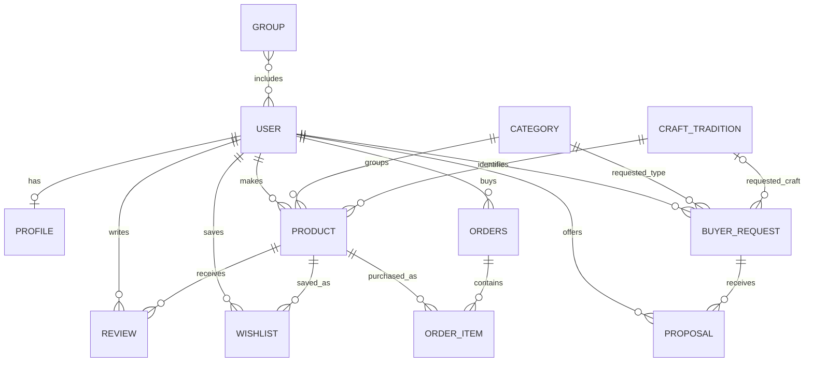

# Database models and relationships

All ten custom models use Django's implicit `BigAutoField` primary key. Django's built-in `auth.User` and `auth.Group` hold accounts and role groups. The database is SQLite by default (`virasat/settings.py`). Fields described as optional use `blank=True` and/or `null=True` in the model; see the cited `models.py` files for exact flags.

| Model (file) | Fields and Django field types | Relationships and important rules |
| --- | --- | --- |
| `Profile` (`accounts/models.py`) | `user` OneToOne, `role` CharField (artisan/buyer/verifier), `phone` CharField, `state` CharField, `city` CharField, `preferred_language` CharField (en/hi), `bio` TextField, `craft_speciality` CharField, `years_of_experience` PositiveSmallIntegerField, `avatar` ImageField, `is_verified` BooleanField, `verification_status` CharField (pending/approved/rejected), `verified_by` ForeignKey, `verified_at` DateTimeField, `created_at` DateTimeField | One-to-one `User` (`user.profile`); verifier `User` (`verified_profiles`). Phone regex starts 6 to 9 and has 10 digits. `can_verify_artisan` permission. Rejection status was added in Phase 3 with the user's approval. |
| `Category` (`catalog/models.py`) | `name` CharField, `slug` SlugField (unique), `description` TextField | `products` and `buyer_requests` reverse relations. |
| `CraftTradition` (`catalog/models.py`) | `name` CharField, `slug` SlugField (unique), `state` CharField, `description` TextField, `gi_tagged` BooleanField, `image` ImageField | `products` and `buyer_requests` reverse relations. |
| `Product` (`catalog/models.py`) | `artisan`, `category`, `craft` ForeignKeys; `title` CharField, `raw_notes` TextField, `materials` CharField, `technique` CharField, `description` TextField, `hindi_description` TextField, `heritage_story` TextField, `care_instructions` TextField, `tags` CharField, `price` DecimalField(10,2), `stock` PositiveIntegerField, `image` ImageField, `status` CharField (draft/published/archived), `ai_source` CharField (ai/fallback/manual), `ai_edited` BooleanField, `view_count` PositiveIntegerField, `created_at` and `updated_at` DateTimeFields | Artisan `User.products`; category/craft `products`. Price ≥ ₹0.01; stock ≥ 0. Indexed on status/date and artisan/status. URL slug comes from the title, not an extra database field. |
| `Review` (`catalog/models.py`) | `product`, `buyer` ForeignKeys; `rating` PositiveSmallIntegerField, `comment` TextField, `created_at` DateTimeField | `Product.reviews`, `User.reviews`; unique pair (product, buyer); rating 1 to 5. View permits reviews only after delivery. |
| `Wishlist` (`catalog/models.py`) | `user`, `product` ForeignKeys; `created_at` DateTimeField | `User.wishlist_entries`, `Product.wishlist_entries`; unique pair (user, product). |
| `Order` (`orders/models.py`) | `buyer` ForeignKey, `full_name` CharField, `phone` CharField, `address` TextField, `city` CharField, `state` CharField, `pincode` CharField, `payment_method` CharField (cod/upi_demo), `total` DecimalField(10,2), `created_at` DateTimeField | `User.orders`; number `VR` plus six-digit ID. `overall_status` derives from items. Six-digit pincode cannot begin with 0. Total can reach zero after all items are cancelled. |
| `OrderItem` (`orders/models.py`) | `order`, `product` ForeignKeys, `quantity` PositiveIntegerField, `unit_price` DecimalField(10,2), `status` CharField (placed/confirmed/shipped/delivered/cancelled), `updated_at` DateTimeField | `Order.items`; `Product.order_items` uses PROTECT to retain purchase history. Quantity ≥ 1; `unit_price` snapshots the checkout price. Indexed by product/status. `artisan_amount()` subtracts `platform_fee()` from `line_total()`. |
| `BuyerRequest` (`linkage/models.py`) | `buyer`, `category`, optional `craft` ForeignKeys; `title` CharField, `description` TextField, `quantity` PositiveIntegerField, `budget_min` and `budget_max` DecimalFields(10,2), `needed_by` DateField, `preferred_state` CharField, `status` CharField (open/closed), `created_at` DateTimeField | `User.buyer_requests`, `Category.buyer_requests`, `CraftTradition.buyer_requests`; indexed by status/date. Date/budget relationship checked in `BuyerRequestForm`. |
| `Proposal` (`linkage/models.py`) | `request`, `artisan` ForeignKeys; `message` TextField, `price_per_unit` DecimalField(10,2), `delivery_days` PositiveSmallIntegerField, `status` CharField (pending/accepted/rejected), `created_at` DateTimeField | `BuyerRequest.proposals`, `User.proposals`; unique pair (request, artisan). Delivery range 1 to 90 days. |

The reverse relation name for each foreign key is set explicitly in the source; these are the names used by the ORM queries.

`ORDERS` in the diagram is the Python model `Order`; `USER` and `GROUP` are built into Django. The `Profile.verified_by` relation also points to `USER` and is optional.
